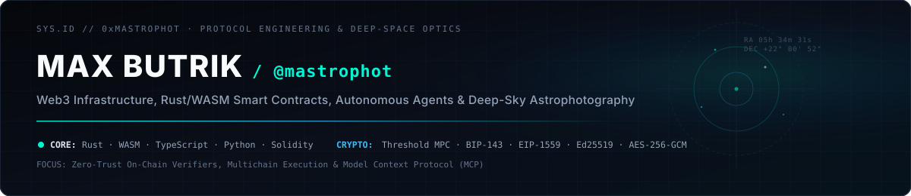

<div align="center">
  

  <br/>

  <p align="center">
    <a href="https://x.com/mastr0phot"></a>
    <a href="https://t.me/mastrophot"></a>
    <a href="https://www.linkedin.com/in/maxbutrik/"></a>
    <a href="https://mastrophot.github.io/lastkey-bunker/"></a>
  </p>
</div>

---

### `01 // FLAGSHIP ARCHITECTURE`

<table>
  <tr>
    <td width="100%">
      <h4>
        🛡️ <a href="https://github.com/mastrophot/lastkey-bunker"><b>LastKey Bunker</b></a> — Zero-Signature Multichain Crypto Bunker &amp; Automatic Inheritance on NEAR MPC
      </h4>
      <p>
        Self-custodial cold bunker, 1-click emergency panic switch, and autonomous dead-man's switch inheritance protocol across <b>Bitcoin (SegWit)</b>, <b>Ethereum / EVM</b>, <b>Solana</b>, and <b>NEAR</b> governed by a single immutable Rust smart contract (<code>aegis.okgoogleok.testnet</code>) and <b>NEAR Chain Signatures (<code>v1.signer</code>)</b>.
      </p>
      <ul>
        <li><b>Zero-Signature Public Key Privacy</b>: Deterministic epoch MPC derivation (<code>aegis/{owner}/{epoch}</code>) keeps deposit addresses unexposed on-chain until Emergency Panic or Automatic Inheritance.</li>
        <li><b>Zero Blind-Signing (On-Chain WASM Bytecode Verifiers)</b>: Pure Rust/WASM parsers verify raw unsigned transactions byte-by-byte before threshold signing — <b>Bitcoin BIP-143 SegWit preimage + outputs</b>, <b>EVM EIP-1559 RLP</b>, <b>Solana binary instructions</b> (with <code>ComputeBudget</code> fee-drain ban), and <b>NEAR Borsh</b>.</li>
        <li><b>Least-Privilege Execution &amp; E2EE</b>: Autonomous 24/7 keepers operate on a scoped <code>FunctionCall</code> key with per-vault gas escrow + automatic gas refunds, 72-hour anti-hijack policy/timer timelock, client-side <code>AES-256-GCM</code> / <code>X25519</code> recipient notes, and zero-metadata Telegram alerts.</li>
      </ul>
      <p>
        <a href="https://mastrophot.github.io/lastkey-bunker/"><b>Live Application ↗</b></a> ·
        <a href="https://github.com/mastrophot/lastkey-bunker"><b>Repository &amp; Verifiers ↗</b></a> ·
        <a href="https://testnet.nearblocks.io/address/aegis.okgoogleok.testnet"><b>Immutable Contract (<code>0</code> Access Keys) ↗</b></a>
      </p>
    </td>
  </tr>
</table>

---

### `02 // SYSTEMS, SECURITY & AGENT INFRASTRUCTURE`

| Repository | Architecture & Scope | Stack |
| :--- | :--- | :--- |
| **[lastkey-bunker](https://github.com/mastrophot/lastkey-bunker)** | Zero-signature multichain cold bunker, 1-click panic evacuation & autonomous inheritance with 4-chain WASM bytecode verifiers. | `Rust` `WASM` `NEAR MPC` `JS` |
| **[near-mcp-contract-security](https://github.com/mastrophot/near-mcp-contract-security)** | Model Context Protocol (MCP) server for automated smart contract vulnerability inspection, access-key auditing, and risk scoring. | `TypeScript` `MCP` `NEAR` |
| **[near-mcp-wallet-manager](https://github.com/mastrophot/near-mcp-wallet-manager)** | Guardrailed MCP wallet execution interface with scoped key permissions and deterministic pre-dispatch checks. | `TypeScript` `MCP` `RPC` |
| **[near-langchain-tx-builder](https://github.com/mastrophot/near-langchain-tx-builder)** | Deterministic transaction construction, dry-run simulation, and schema validation pipeline for autonomous agents. | `Python` `NEAR` `LLM Tools` |
| **[near-developer-suite-vscode](https://github.com/mastrophot/near-developer-suite-vscode)** | VS Code developer suite for inspecting on-chain state, decoding transaction receipts, and managing contract deployments. | `TypeScript` `VS Code API` |
| **[near-contract-size-check-action](https://github.com/mastrophot/near-contract-size-check-action)** | CI/CD GitHub Action enforcing deterministic WASM binary size budgets and build verification on every commit. | `JavaScript` `GitHub Actions` |
| **[near-fastapi](https://github.com/mastrophot/near-fastapi)** | High-throughput asynchronous REST microservice for indexing and querying NEAR RPC state. | `Python` `FastAPI` `AsyncIO` |
| **[medicaid-fraud-signal-engine](https://github.com/mastrophot/medicaid-fraud-signal-engine)** | Analytical CLI anomaly-detection engine extracting statistical outlier signals from large public datasets. | `Python` `Data Pipeline` |

---

### `03 // TECHNICAL MATRIX`

```text
LANGUAGES & RUNTIMES    Rust · WebAssembly (WASM) · TypeScript · JavaScript (Node.js) · Python · Solidity · SQL
CRYPTOGRAPHY & ON-CHAIN Threshold ECDSA (Secp256k1) · Ed25519 / X25519 · AES-256-GCM · BIP-143 PSBT · EIP-1559 RLP · Borsh
PROTOCOLS & INFRA       NEAR Protocol (Chain Signatures / MPC) · Bitcoin SegWit · EVM · Solana · Model Context Protocol (MCP)
DEVOPS & VERIFICATION   GitHub Actions 24/7 Keepers · Cloudflare Workers (Edge) · Docker · Deterministic Unit & Bytecode Testing
OFF-TERMINAL            Deep-Sky Astrophotography · Equatorial Mount Guiding · Narrowband & Broadband Calibration Stacking
```
